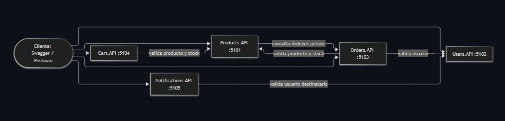

# E-Commerce: arquitectura de microservicios

Trabajo práctico grupal de Arquitectura y Diseño de Software. Sistema de e-commerce dividido en cinco
microservicios REST, cada uno con su propia responsabilidad, desarrollado en C# con .NET 10.

## Integrantes

| Integrante | Apellido | Legajo |
|---|---|---|
| Vanina | Vargas | 882586 |
| Noelia | Ajnota | 892376 |
| Florencia | Giannini | 892718 |

## Tecnologías

| Propósito | Tecnología |
|---|---|
| Framework | .NET 10 / ASP.NET Core (Web API con controladores) |
| Documentación de la API | Swashbuckle.AspNetCore 6.9.0 (Swagger UI) |
| Logging | Serilog con sinks de consola y archivo JSON |
| Validación | Data Annotations |
| Comunicación entre servicios | `IHttpClientFactory` (clientes HTTP tipados) |
| Manejo de errores | `IExceptionHandler` + `ProblemDetails` |
| Health checks | `Microsoft.Extensions.Diagnostics.HealthChecks` |
| Persistencia | Detrás de interfaces (`I...Repository`). Ver [Persistencia](#persistencia) |

## Servicios y puertos

| Servicio | Responsabilidad | Puerto | Swagger |
|---|---|---|---|
| Products.API | Catálogo de productos (CRUD) | 5101 | http://localhost:5101/swagger |
| Users.API | Registro, login y bloqueo de cuentas | 5102 | http://localhost:5102/swagger |
| Orders.API | Creación y seguimiento de órdenes | 5103 | http://localhost:5103/swagger |
| Cart.API | Carrito de compras por usuario | 5104 | http://localhost:5104/swagger |
| Notifications.API | Registro y envío simulado de notificaciones | 5105 | http://localhost:5105/swagger |

## Cómo ejecutar

Requisito: **.NET SDK 10** o superior (`dotnet --version`).

```bash
git clone <url-del-repositorio>
cd ECommerce
dotnet build ECommerce.sln
```

Cada servicio se levanta en **su propia terminal**, desde la raíz del repositorio (el orden no importa):

```bash
dotnet run --project src/Products.API
dotnet run --project src/Users.API
dotnet run --project src/Orders.API
dotnet run --project src/Cart.API
dotnet run --project src/Notifications.API
```

Cada servicio imprime en consola el puerto en el que escucha. Los datos se guardan en memoria: **se
pierden al reiniciar el servicio**.

### Prueba rápida

1. Abrir `http://localhost:5102/swagger`, registrar un usuario y copiar su `id`.
2. En `http://localhost:5101/swagger`, crear un producto con stock y copiar su `id`.
3. En `http://localhost:5103/swagger`, crear una orden con ese usuario y ese producto.

El flujo completo, con casos de éxito y de error, está en [docs/pruebas-integrales.http](docs/pruebas-integrales.http)
(se ejecuta con la extensión REST Client de VS Code).

## Endpoints

### Products.API

| Método | Ruta | Descripción | Respuestas |
|---|---|---|---|
| GET | `/api/products` | Lista productos (`?categoria=` y `?nombre=`) | 200, 500 |
| GET | `/api/products/{id}` | Obtiene un producto | 200, 404, 500 |
| POST | `/api/products` | Crea un producto | 201, 400, 409, 500 |
| PUT | `/api/products/{id}` | Actualiza un producto | 200, 400, 404, 500 |
| DELETE | `/api/products/{id}` | Elimina un producto | 204, 404, 409, 500 |

### Users.API

| Método | Ruta | Descripción | Respuestas |
|---|---|---|---|
| POST | `/api/users/register` | Registra un usuario | 201, 400, 409, 500 |
| POST | `/api/users/login` | Autentica con email y contraseña | 200, 400, 401, 403, 500 |
| GET | `/api/users/{id}` | Obtiene un usuario (**adicional**, ver [decisiones](#decisiones-de-diseño)) | 200, 404, 500 |

### Orders.API

| Método | Ruta | Descripción | Respuestas |
|---|---|---|---|
| GET | `/api/orders` | Lista órdenes (`?usuarioId=`) | 200, 500 |
| GET | `/api/orders/{id}` | Obtiene una orden | 200, 404, 500 |
| POST | `/api/orders` | Crea una orden | 201, 400, 404, 422, 500 |
| PUT | `/api/orders/{id}/status` | Cambia el estado de la orden | 200, 400, 404, 409, 500 |

### Cart.API

| Método | Ruta | Descripción | Respuestas |
|---|---|---|---|
| GET | `/api/cart/{userId}` | Obtiene el carrito | 200, 404, 500 |
| POST | `/api/cart/{userId}/items` | Agrega un producto | 200, 400, 404, 422, 500 |
| PUT | `/api/cart/{userId}/items/{productId}` | Cambia la cantidad | 200, 400, 404, 422, 500 |
| DELETE | `/api/cart/{userId}/items/{productId}` | Quita un producto | 204, 404, 500 |
| DELETE | `/api/cart/{userId}` | Vacía el carrito | 204, 404, 500 |

### Notifications.API

| Método | Ruta | Descripción | Respuestas |
|---|---|---|---|
| POST | `/api/notifications/send` | Registra y simula el envío | 201, 400, 404, 500 |
| GET | `/api/notifications/{userId}` | Lista las notificaciones de un usuario | 200, 404, 500 |

## Arquitectura

```
                       +---------------------------+
                       |  Cliente (Swagger / HTTP) |
                       +-------------+-------------+
                                     |
     +-----------+-----------+-------+-------+-------------+
     |           |           |               |             |
  Users        Products     Orders          Cart       Notifications
  :5102         :5101       :5103           :5104          :5105

  Cart          --> Products        valida producto y stock
  Orders        --> Users           valida que el usuario exista
  Orders        --> Products        valida producto y stock, toma el precio
  Products      --> Orders          busca órdenes activas antes de borrar
  Notifications --> Users           valida que el destinatario exista
```



Más detalle, un diagrama de secuencia y las decisiones de diseño en [docs/arquitectura.md](docs/arquitectura.md).

### Comunicación entre servicios

| Origen | Destino | Motivo | Error si falla |
|---|---|---|---|
| Cart.API | Products.API | Validar producto y stock | CRT-002, CRT-003 |
| Orders.API | Users.API | Validar usuario | ORD-003 |
| Orders.API | Products.API | Validar productos, stock y precio | ORD-004, ORD-005 |
| Products.API | Orders.API | Impedir borrar productos con órdenes activas | PRD-004 |
| Notifications.API | Users.API | Validar destinatario | NTF-001 |

Las llamadas usan `IHttpClientFactory` con un timeout de 5 segundos. Los clientes siempre revisan el
status HTTP antes de leer el body. Las URLs de los otros servicios están en el `appsettings.json` de cada uno.

## Manejo de errores

Todo error 4xx/5xx se devuelve con el formato de `ProblemDetails` más tres campos propios:

```json
{
  "type": "https://tools.ietf.org/html/rfc7231#section-6.5.4",
  "title": "Not Found",
  "status": 404,
  "detail": "El recurso solicitado no fue encontrado.",
  "instance": "/api/products/99",
  "errorCode": "PRD-001",
  "errorMessage": "Producto no encontrado.",
  "correlationId": "5f1c2d3e4a5b46789abc0123456789ab"
}
```

Los servicios lanzan excepciones de dominio (`NotFoundException`, `BusinessRuleException`,
`ValidationException`, etc.) con su `ErrorCode`; un `IExceptionHandler` por tipo las convierte en la
respuesta HTTP. No hay `try/catch` en los controladores y nunca se devuelve un stack trace.

### Catálogo de códigos de error

| Código | HTTP | Mensaje | Cuándo |
|---|---|---|---|
| PRD-001 | 404 | Producto no encontrado. | GET/PUT/DELETE con un ID inexistente |
| PRD-002 | 400 | Los datos del producto son inválidos. | POST/PUT con campos faltantes o formato incorrecto |
| PRD-003 | 409 | Ya existe un producto con ese nombre en la categoría. | POST de un duplicado |
| PRD-004 | 409 | El producto tiene órdenes activas y no puede eliminarse. | DELETE con órdenes Pendiente o Confirmada |
| PRD-005 | 500 | Error interno al procesar el producto. | Error inesperado |
| USR-001 | 409 | El email ya está registrado. | Registro con un email existente |
| USR-002 | 400 | Los datos del usuario son inválidos. | Registro o login con datos inválidos |
| USR-003 | 401 | Credenciales incorrectas. | Login con email o contraseña incorrectos |
| USR-004 | 403 | Usuario bloqueado por demasiados intentos fallidos. | Tercer intento fallido consecutivo |
| USR-005 | 403 | Usuario bloqueado por detección de fraude. | Login de un usuario bloqueado manualmente |
| USR-006 | 500 | Error interno al procesar el usuario. | Error inesperado |
| USR-007 | 404 | Usuario no encontrado. | GET de un usuario inexistente (**adicional**) |
| ORD-001 | 404 | Orden no encontrada. | GET/PUT con un ID inexistente |
| ORD-002 | 400 | Los datos de la orden son inválidos. | POST con campos faltantes o lista de items vacía |
| ORD-003 | 404 | Usuario no encontrado al crear la orden. | POST con un usuario inexistente |
| ORD-004 | 404 | Producto no encontrado al crear la orden. | POST con un producto inexistente |
| ORD-005 | 422 | Stock insuficiente para uno o más productos. | POST con cantidad mayor al stock |
| ORD-006 | 409 | El estado de la orden no puede ser modificado. | PUT de estado con una transición no permitida |
| ORD-007 | 500 | Error interno al procesar la orden. | Error inesperado |
| CRT-001 | 404 | Carrito no encontrado. | GET/PUT/DELETE de un usuario sin carrito, o de un producto que no está en él |
| CRT-002 | 404 | Producto no encontrado. | POST/PUT con un producto inexistente |
| CRT-003 | 422 | Stock insuficiente para agregar al carrito. | POST/PUT con cantidad mayor al stock |
| CRT-004 | 400 | Cantidad inválida. | POST/PUT con cantidad menor o igual a cero |
| CRT-005 | 500 | Error interno al procesar el carrito. | Error inesperado |
| NTF-001 | 404 | Usuario destinatario no encontrado. | POST con un destinatario inexistente |
| NTF-002 | 400 | Los datos de la notificación son inválidos. | POST con campos faltantes o tipo no reconocido |
| NTF-003 | 404 | No se encontraron notificaciones para el usuario. | GET de un usuario sin notificaciones |
| NTF-004 | 500 | Error interno al procesar la notificación. | Error inesperado |

El `errorMessage` de cada respuesta incluye el detalle concreto (por ejemplo, el stock disponible). La
tabla muestra el mensaje general del catálogo.

## Logging y Correlation ID

- **Serilog** escribe a dos destinos: la consola (formato legible) y un archivo JSON por día en
  `logs/<servicio>-AAAAMMDD.log`, dentro de la carpeta de cada servicio. La carpeta `logs/` no se sube al repositorio.
- Cada log incluye fecha y hora, nivel, servicio, endpoint, Correlation ID y, cuando aplica, `ErrorCode`.
- Se registra el **inicio** y el **fin** de cada request, con el status y la duración.
- Los errores de negocio se registran como **Warning** y los errores inesperados como **Error**.
- Cada request recibe un **`X-Correlation-Id`** (se genera uno, o se reutiliza el que llega en el header).
  Se devuelve en la respuesta, aparece en todos los logs del request, se **reenvía** en las llamadas a otros
  servicios y se incluye como `correlationId` en las respuestas de error. Con ese id se sigue un pedido a
  través de todos los servicios.

## Health checks

Cada servicio expone tres endpoints, que devuelven JSON con el estado `Healthy`, `Degraded` o `Unhealthy`:

| Endpoint | Pregunta que responde |
|---|---|
| `GET /health` | Estado general: todos los chequeos |
| `GET /health/live` | ¿El proceso está vivo? |
| `GET /health/ready` | ¿Puede atender pedidos? (sus dependencias responden) |

| Servicio | Dependencias que chequea `ready` | Si una no responde |
|---|---|---|
| Products.API | Orders.API | Degraded |
| Users.API | ninguna | siempre Healthy |
| Orders.API | Users.API y Products.API | Degraded |
| Cart.API | Products.API | Degraded |
| Notifications.API | Users.API | Degraded |

## Estructura del repositorio

```
ECommerce/
├── ECommerce.sln
├── README.md
├── docs/
│   ├── arquitectura.md          Diagramas y decisiones de diseño
│   ├── arquitectura.png         Diagrama de arquitectura
│   ├── pruebas-integrales.http  Flujo completo, errores y health checks
│   ├── guion-demo.md            Guion de la demo
│   └── capturas/                Capturas de Swagger con errores
└── src/
    ├── Products.API/
    ├── Users.API/
    ├── Orders.API/
    ├── Cart.API/
    └── Notifications.API/
```

Estructura interna de cada servicio:

```
<Servicio>.API/
├── Controllers/          Reciben las peticiones HTTP
├── Models/               Entidades del dominio
├── DTOs/                 Request y Response
├── Services/             Lógica de negocio
├── Persistence/          Acceso a datos (interfaz + implementación)
├── Clients/              Clientes HTTP hacia otros servicios
├── Exceptions/           Excepciones de dominio y catálogo de códigos
├── ExceptionHandlers/    IExceptionHandler por tipo de excepción
├── Middleware/           Correlation ID
├── HealthChecks/         Chequeos de dependencias
├── Swagger/              Ejemplos de error para Swagger
├── logs/                 Archivos de log (no se versionan)
└── Program.cs
```

## Decisiones de diseño

- **Endpoint adicional `GET /api/users/{id}`.** La consigna solo define register y login en Users, pero
  Orders.API y Notifications.API necesitan verificar que un usuario existe. Devuelve `USR-007` si no existe.
- **Transiciones de estado de una orden.** Pendiente → Confirmada o Cancelada; Confirmada → Enviada o
  Cancelada; Enviada → Entregada. Entregada y Cancelada son estados finales. Cualquier otra da `ORD-006`.
- **PRD-004 sin ampliar Orders.** Para saber si un producto tiene órdenes activas, Products pide
  `GET /api/orders` y filtra por estado (Pendiente o Confirmada) y por producto. Si Orders no responde, el
  producto **no se borra** (error `PRD-005`).
- **Las órdenes no descuentan stock.** La consigna pide validar el stock al crear la orden, no modificarlo.
- **Contraseñas con PBKDF2** y sal aleatoria por usuario; nunca se devuelven en una respuesta.
- **Un solo código por situación.** Los códigos de error son constantes (`ErrorCodes.PRD_001`), no strings sueltos.

## Persistencia

La capa de servicios depende de interfaces (`IProductRepository`, `IUserRepository`, etc.) y no de una
tecnología concreta. Hoy cada servicio usa una implementación **en memoria** (`InMemory...Repository`).
Para conectar otra tecnología de persistencia alcanza con escribir una clase que implemente la interfaz y
registrarla en `Program.cs`; la lógica de negocio no cambia.

## Documentación

- [Arquitectura y decisiones](docs/arquitectura.md)
- [Pruebas integrales](docs/pruebas-integrales.http)
- [Guion de la demo](docs/guion-demo.md)
- [Capturas de Swagger con errores](docs/capturas/README.md)