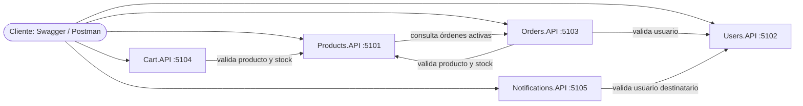

# Arquitectura del sistema

## Vista general

## Comunicación entre servicios

Todas las llamadas entre servicios son HTTP síncronas (`IHttpClientFactory`).

| Origen | Destino | Motivo |
| Cart.API | Products.API | Verificar que el producto existe y hay stock (CRT-002, CRT-003) |
| Orders.API | Users.API | Verificar que el usuario existe (ORD-003) |
| Orders.API | Products.API | Verificar productos, stock y capturar el precio (ORD-004, ORD-005) |
| Products.API | Orders.API | Impedir borrar productos con órdenes Pendiente o Confirmada (PRD-004) |
| Notifications.API | Users.API | Verificar que el destinatario existe (NTF-001) |

## Decisiones de diseño

- **Un servicio, una responsabilidad.** Cada servicio maneja su propio dominio y no
  accede a los datos de otro: solo lo consulta por su API.
- **Base de datos por servicio.** Ningún servicio comparte tablas con otro.
- **Persistencia detrás de una interfaz.** La capa de servicios depende de una
  interfaz de repositorio, no de la librería concreta de persistencia. Así la lógica
  de negocio se puede probar y desarrollar sin acoplarse al almacenamiento.
- **Errores centralizados.** Los servicios lanzan excepciones de dominio con su
  `errorCode`; los `IExceptionHandler` las convierten en la respuesta HTTP, sin
  `try/catch` en los controladores.
- **Trazabilidad.** Cada request lleva un `X-Correlation-Id` que se propaga entre
  servicios y aparece en los logs.