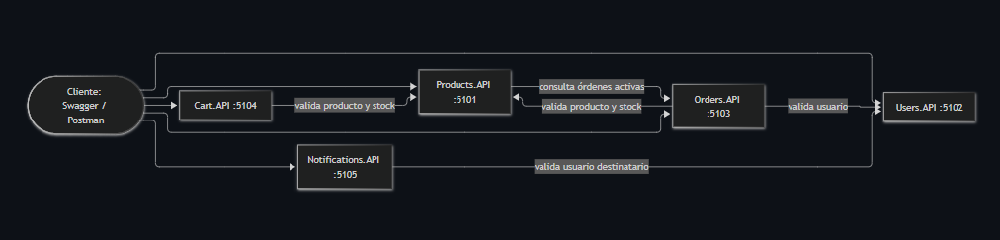
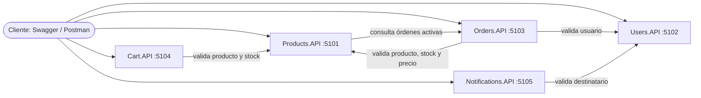
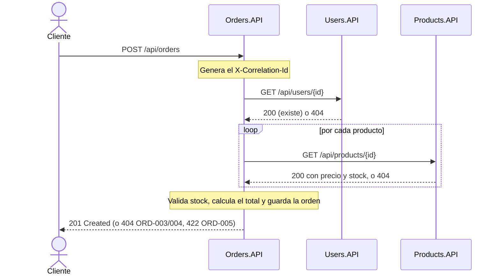

# Arquitectura del sistema



## Vista general



## Qué pasa al crear una orden



El mismo `X-Correlation-Id` viaja en las llamadas a Users y a Products, así que aparece en los logs de los tres servicios.

## Comunicación entre servicios

Todas las llamadas son HTTP síncronas con `IHttpClientFactory`, timeout de 5 segundos.

| Origen | Destino | Motivo |
|---|---|---|
| Cart.API | Products.API | Verificar que el producto existe y hay stock (CRT-002, CRT-003) |
| Orders.API | Users.API | Verificar que el usuario existe (ORD-003) |
| Orders.API | Products.API | Verificar productos, stock y capturar el precio (ORD-004, ORD-005) |
| Products.API | Orders.API | Impedir borrar productos con órdenes Pendiente o Confirmada (PRD-004) |
| Notifications.API | Users.API | Verificar que el destinatario existe (NTF-001) |

## Capas de cada servicio

```
Controller  ->  Service  ->  Repository (interfaz)  ->  almacenamiento
                   |
                   +-->  Client (HTTP hacia otro servicio)
Excepciones de dominio  ->  IExceptionHandler  ->  respuesta con errorCode
```

- El **controlador** solo recibe y responde: no tiene lógica ni `try/catch`.
- El **service** concentra las reglas de negocio y lanza excepciones de dominio con su código.
- El **repositorio** es una interfaz: se puede cambiar la tecnología de persistencia sin tocar el service.
- El **client** encapsula el `HttpClient` hacia otro servicio: el service no sabe que hay HTTP.

## Decisiones de diseño

- **Un servicio, una responsabilidad.** Cada servicio maneja su dominio y no accede a los datos de otro: solo los consulta por su API.
- **Datos propios por servicio.** Ningún servicio comparte almacenamiento con otro.
- **Errores centralizados.** Los services lanzan excepciones con su `errorCode`; los `IExceptionHandler` las convierten en la respuesta HTTP, registrados del más específico al más genérico.
- **Trazabilidad.** `X-Correlation-Id` por request, reenviado entre servicios, presente en los logs y en las respuestas de error.
- **Degradación controlada.** Si un servicio del que depende otro no responde, el `ready` del segundo pasa a `Degraded` en lugar de caerse.
- **Fallar cerrado.** Si Products no puede confirmar que un producto no tiene órdenes activas, no lo borra.