# Capturas de Swagger UI

Capturas de Swagger UI mostrando las respuestas de **error con `errorCode` y `errorMessage`**, como pide la entrega.

## Swagger de cada servicio

| Servicio | Captura | Debe verse |
|---|---|---|
| Products.API | 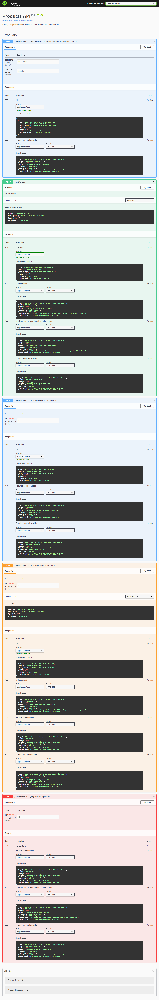 | Los cinco endpoints con sus respuestas |
| Users.API | 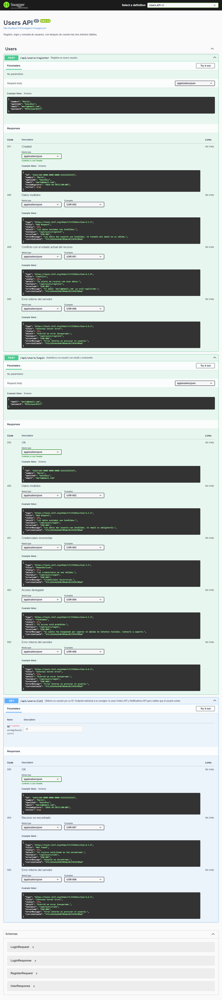 | Los tres endpoints con sus respuestas |
| Orders.API | 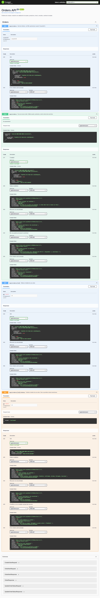 | Los cuatro endpoints con sus respuestas |
| Cart.API | 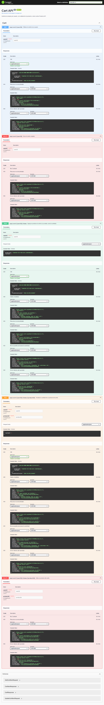 | Los cinco endpoints con sus respuestas |
| Notifications.API | 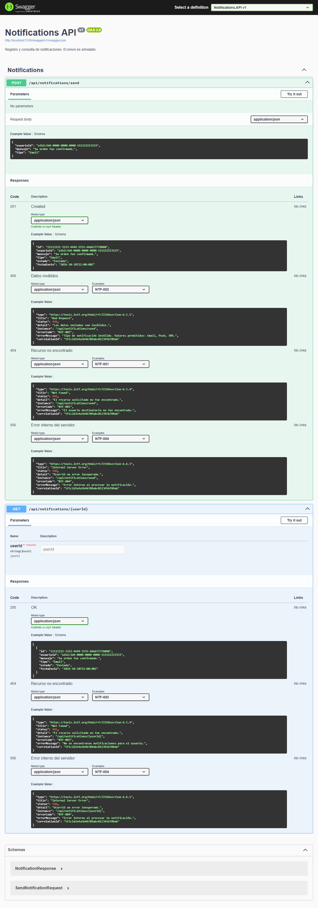 | Los dos endpoints con sus respuestas |

## Errores ejecutados con "Try it out"

| Error | Captura | Request |
|---|---|---|
| PRD-001 (404) | 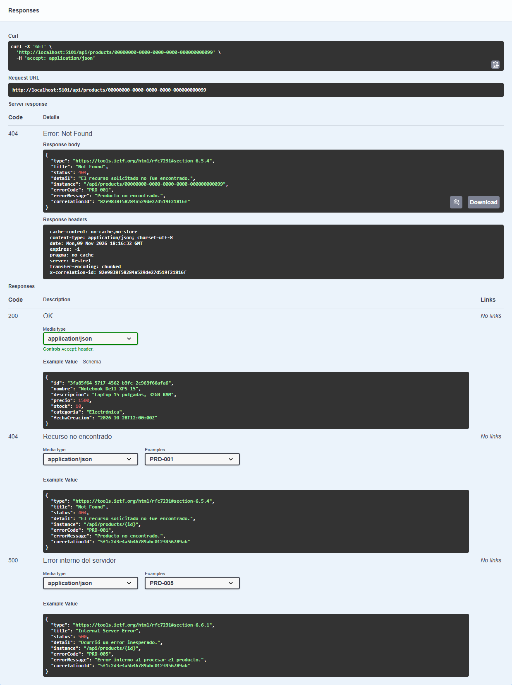 | `GET /api/products/99` |
| PRD-003 (409) | 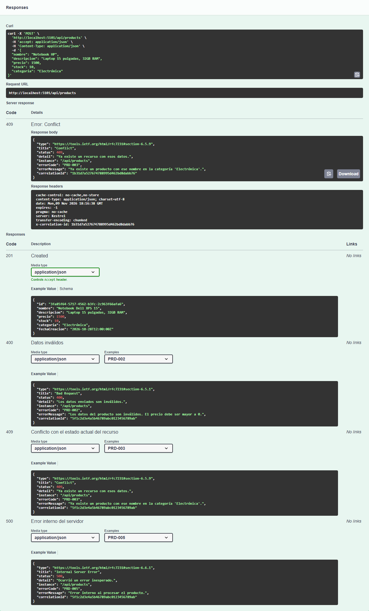 | `POST /api/products` con un producto repetido |
| PRD-004 (409) | 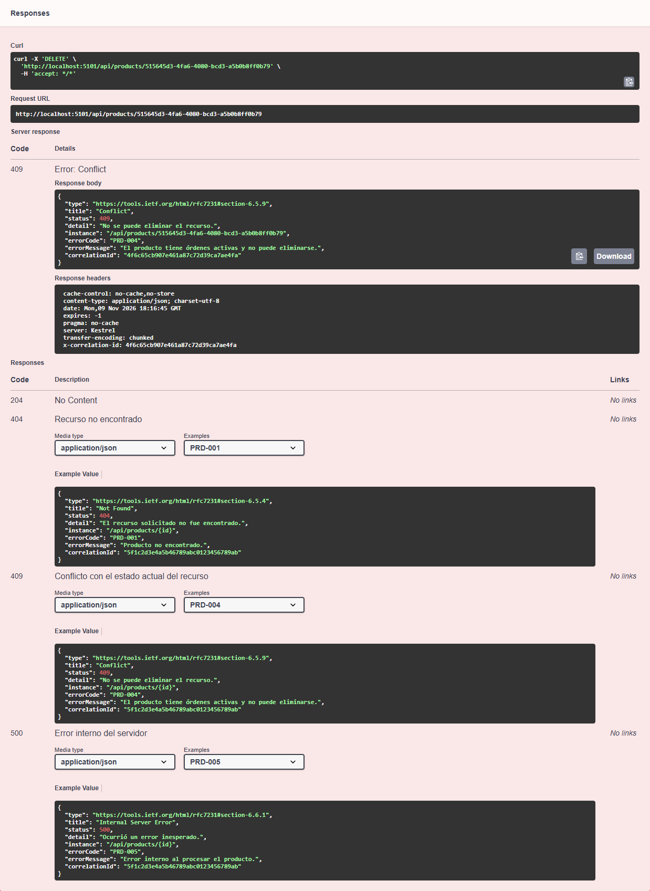 | `DELETE` de un producto con una orden activa |
| USR-003 (401) |  | `POST /api/users/login` con contraseña incorrecta |
| USR-004 (403) | 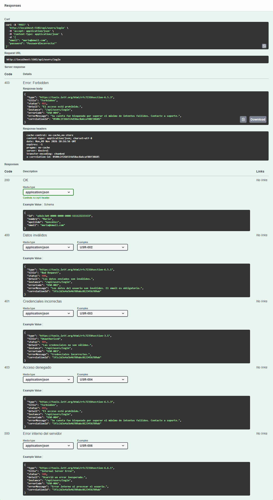 | Tercer login fallido consecutivo |
| ORD-005 (422) | 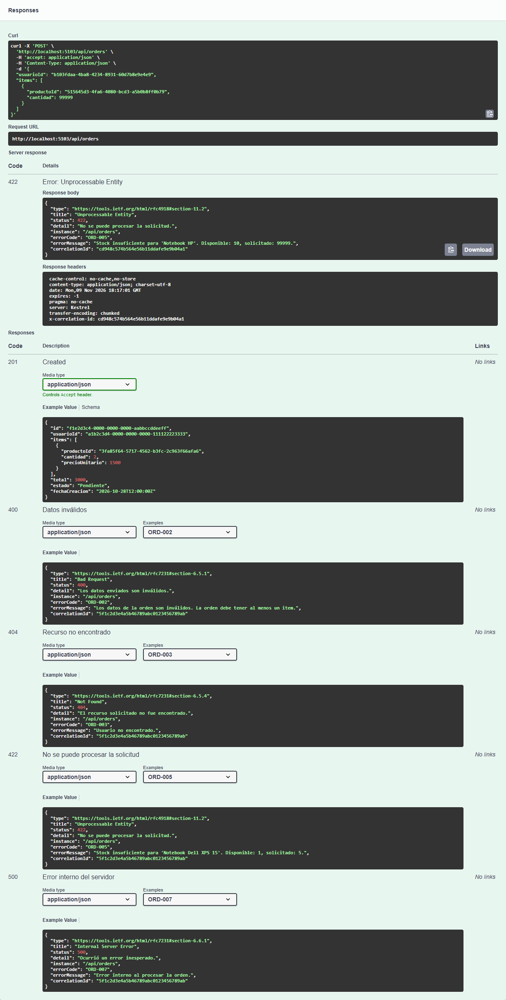 | `POST /api/orders` con más cantidad que el stock |
| ORD-006 (409) | 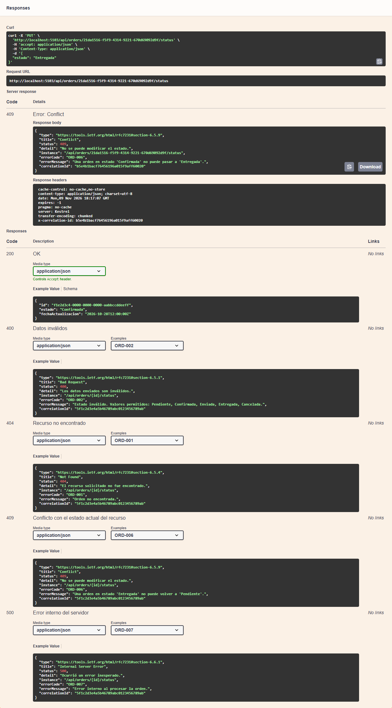 | `PUT /api/orders/{id}/status` con una transición no permitida |
| CRT-003 (422) | 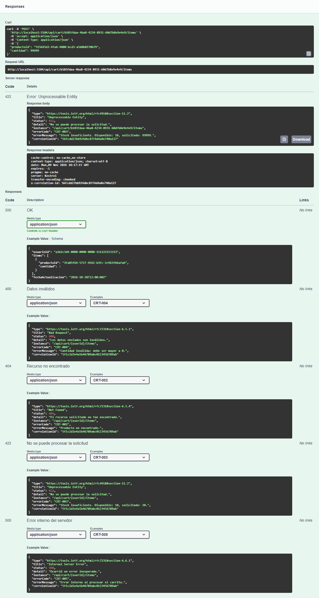 | `POST /api/cart/{userId}/items` con más cantidad que el stock |
| NTF-001 (404) | 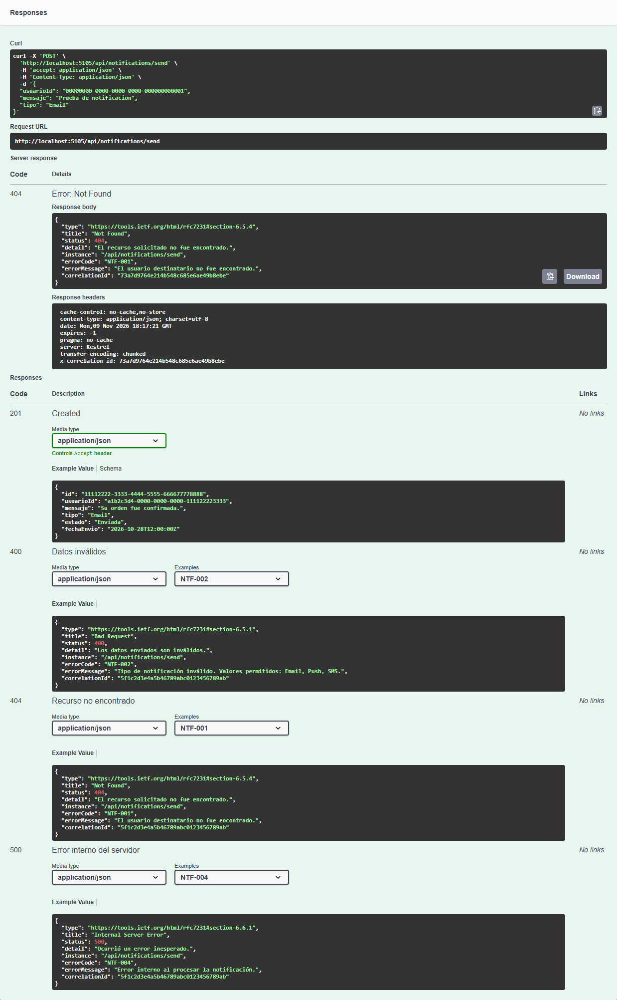 | `POST /api/notifications/send` con un usuario inexistente |

En cada captura de error tiene que verse el **código de respuesta**, el **cuerpo JSON** con `errorCode`,
`errorMessage` y `correlationId`, y los **headers** de la respuesta con `x-correlation-id`.
